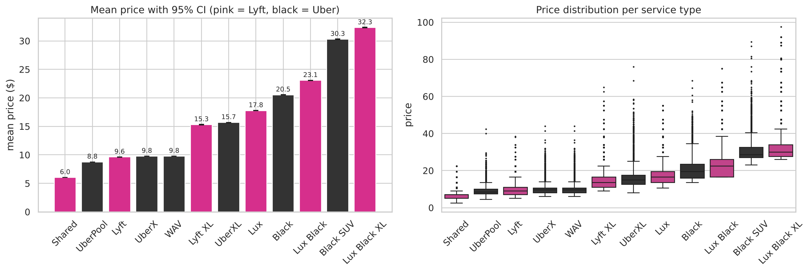
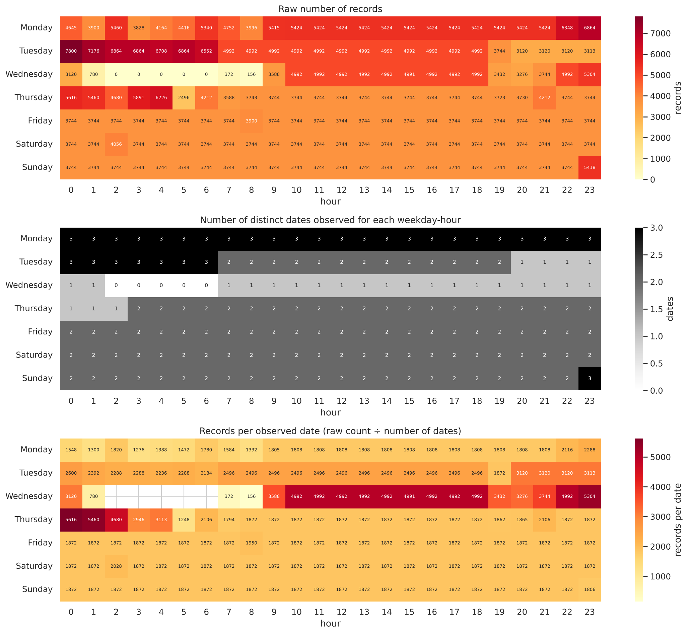
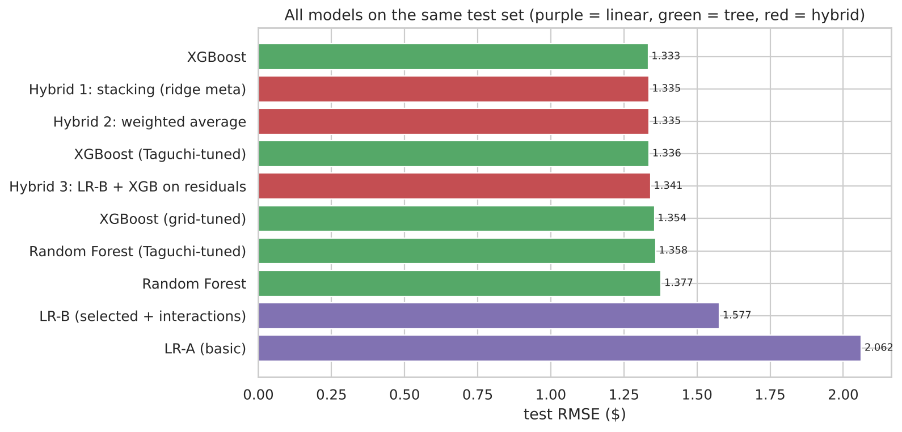
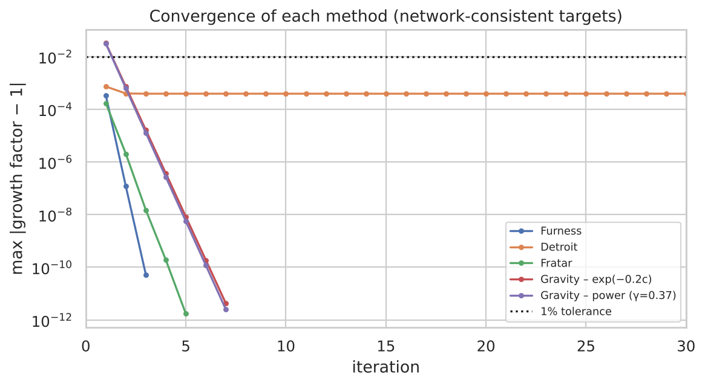

# Uber & Lyft in Boston

This is our project for the Transportation Planning course at Sharif University of Technology (fall 2025). It had two phases: the first was mostly data analysis and price prediction, and the second was about OD matrices and trip distribution models. Both are in [`transportation_project.ipynb`](transportation_project.ipynb).

We used the [Uber and Lyft Dataset Boston, MA](https://www.kaggle.com/datasets/brllrb/uber-and-lyft-dataset-boston-ma) from Kaggle. It has around 693k rows covering 12 areas of central Boston from Nov 26 to Dec 18, 2018, along with the weather for each hour.

## Contents

Part A (phase 1):
- basic exploration of the data and encoding the categorical columns
- tests on whether price depends on the service type (ANOVA, Kruskal-Wallis, Tukey, Games-Howell), normality tests and outlier removal
- PCA and k-means on the weather data, and two classifiers for predicting rain
- feature selection and price models: linear regression, random forest, XGBoost, tuning with Taguchi and grid search, and stacking

Part B (phase 2):
- OD matrices for the whole period and for each day of the week
- trip distribution with Furness, Detroit, Fratar and the gravity model
- a small integer program for planning trips for a new company with a 20 km/day limit

## Results

The dataset turned out not to be real trips. Someone collected price quotes from the apps on a fixed schedule, so the number of records per hour or per day tells you when the data was collected, not when people were riding. We only noticed this when we divided the counts by the number of days in the data and the heatmap went flat.

Price depends almost entirely on the service type, the distance and the surge multiplier (surge only exists for Lyft in this data). Weather and time of day made no difference in any of the models. XGBoost gave the best results (R² of 0.976 on the test set, mean error about 95 cents). Taguchi got close to the best grid search setting with 9 runs instead of 81. Stacking didn't do better than XGBoost alone.

For predicting rain, a random forest got an F1 of about 0.72 on days it hadn't seen. You have to drop precipProbability and the weather summary columns first, because they basically contain the answer.

In phase 2, all the distribution methods converged in one or two iterations. That's because trips in this data only go between two groups of six areas, and the future totals we were given don't quite fit that structure, so no method can get closer than about 0.34%. With adjusted totals, Furness was the fastest and Detroit got stuck at about 0.04% error. For the revenue model, the best plan with 20 km a day earns about 1,830 dollars a week, or about 1,520 if the car has to come back to the areas it leaves from.

| Price by service type | Records per weekday and hour |
|---|---|
|  |  |

| Price models compared | Convergence of the distribution methods |
|---|---|
|  |  |

## How to run

Download `rideshare_kaggle.csv` from Kaggle and put it in the `data` folder. It's too big to keep in the repo. Then:

```bash
pip install -r requirements.txt
jupyter notebook transportation_project.ipynb
```

Running everything takes about 10 minutes, mostly because of the grid search. Plots get saved to `figures/` and the Excel outputs to `outputs/`.

We had a shortened version of the csv from the course (39 of the 57 columns). The notebook only uses columns that exist in both, so the Kaggle version should work too, though some numbers may be slightly different.

## Team

Amirabbas Donyadideh, Arshia Sattari Khavas and Alireza Faraji. Instructor: Dr. Hassannayebi.
